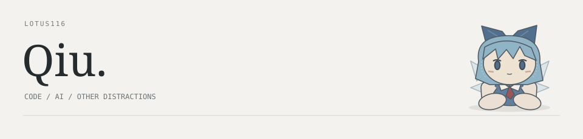

## Hi, I’m Qiu ❄

喜欢从「这东西为什么不好用？」开始，做一点能用、也有意思的小东西。

在 AI、产品和游戏之间反复横跳。兴趣会换季，好奇心常驻。

HKU · MSc Computer Science / AI × 人机协作 / Minecraft · Touhou

### 最近在折腾

- [LectureFlow](https://github.com/lotus116/LectureFlow)：让英语课堂更容易跟上，也更容易回顾。
- [SideLens](https://github.com/lotus116/SideLens)：给人和 AI 的协作，多一个不只会点头的视角。`探索原型`
- [BuildLens](https://github.com/lotus116/BuildLens)：在 Minecraft 里造房子，也研究怎样读懂建筑。

---

先做点有意思的，再看看有没有用。

⑨ 最强的是好奇心，代码另说。

琪露诺主题原创矢量同人图 · Touhou Project / © 上海アリス幻樂団
