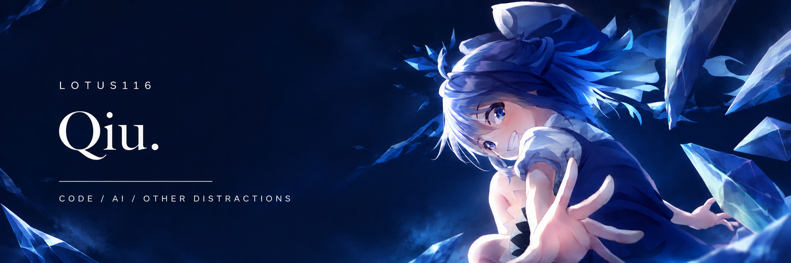

  

 

**写代码，研究 AI，做些有乐子的东西。**

HKU · MSc Computer Science &nbsp; / &nbsp; AI · 人机协作 · gamer

 

### 一些项目

**[LectureFlow ↗](https://github.com/lotus116/LectureFlow)**  
英语课堂的实时理解与课后回顾。

**[SideLens ↗](https://github.com/lotus116/SideLens)**  
探索人和 AI 协作时，另一种视角能带来什么。原型

**[BuildLens ↗](https://github.com/lotus116/BuildLens)**  
Minecraft 建筑分析与辅助工具。

 

---

人类的问题很多，我暂时只处理能复现的。

封面基于提供的琪露诺插画改编 · Touhou Project
